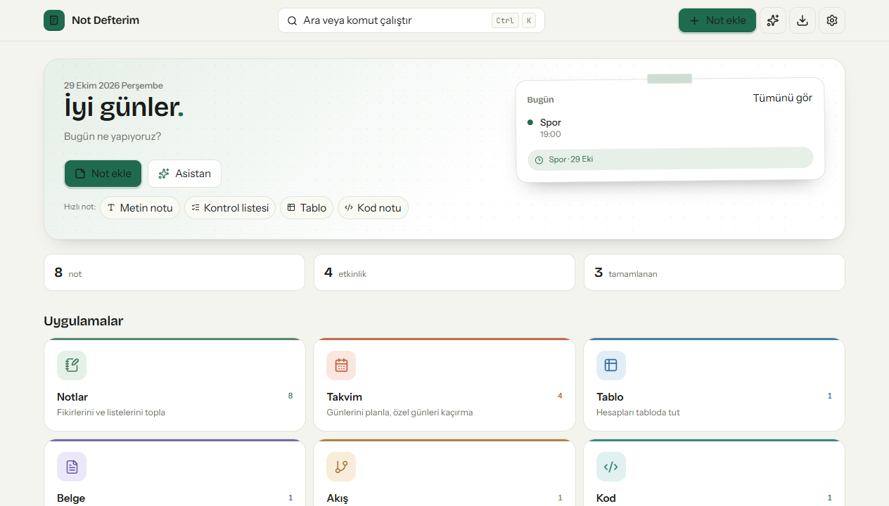

# Not Defterim

**Canlı:** https://notdefterim.surge.sh

Notların, takvimin ve fikirlerin tek yerde. Açılışta uygulama seçersin; not, takvim, tablo, belge, akış şeması ve kod notu aynı çatı altında çalışır. Cihaz içi asistan not ekler, takvime etkinlik yazar, listeleri günceller, notlarını özetler ve koddaki hataları işaretler. İnternet gerekmez.



## Ne var?

| Modül | Yaptığı |
|---|---|
| **Notlar** | Başlıklı notlar; metin, kontrol listesi, tablo, belge, kod ve akış notları. Arama, sabitleme, arşiv |
| **Takvim** | Aylık görünüm, etkinlik ve **özel gün** işaretleme, seçilen güne **serbest gün notu**, etkinlikten 24 saat önce hatırlatma |
| **Tablo** | Hücre düzenleme, `=TOPLA / =ORTALAMA / =MAK / =MİN / =SAY`, toplam satırı, CSV indirme |
| **Belge** | Başlık, liste, alıntı, kalın/italik; kelime sayısı |
| **Akış** | “Başla” ile başlar; eklediğin her şekil zincirin sonuna bağlanır, sürükle-bırak, PNG dışa aktarma |
| **Kod** | Satır numaralı editör, JavaScript çalıştırma, **AI ile statik hata incelemesi** |
| **Asistan** | Sohbet + gerçek işlem: not oluştur, listeye madde ekle, takvime etkinlik yaz, özet çıkar, not ara, kodu incele |

Ek olarak:

- **Üç tema:** Açık, Gece ve **Renkli** (8 palet + özel vurgu rengi)
- **Türkçe / İngilizce** arayüz, anında geçiş
- **Kalıcı veri:** IndexedDB; sayfa kapansa da notlar, etkinlikler, sohbet ve işlem geçmişi yerinde
- **Yedek:** JSON dışa/içe aktarma
- **Bildirimler:** aç/kapa, tarayıcı izni, etkinlikten bir gün önce uyarı
- **Bildirim sesi:** 8 klasik + 2 özel tasarım (Defter, Mürekkep) — Web Audio ile üretilir, dosya/telif yok
- **Kurulabilir uygulama (PWA):** telefonda ve masaüstünde simgeyle açılır, çevrimdışı çalışır
- **Mobil uyum:** alt gezinme çubuğu, dokunmatik dostu paneller
- **Komut paleti:** `Ctrl/⌘ + K` ile not ara, tema değiştir, yeni not/etkinlik aç
- **Geri tuşu:** Açık bir not/panel varken tarayıcı geri tuşu siteyi bırakmaz, paneli kapatır
- **Asistan hafızası:** Sohbeti ve “bana gardaş diye hitap et” gibi tercihleri tarayıcıda saklar
- **Konuşma tarzı:** Arkadaşça, Resmi, Kısa, Uzun, Hafif argo veya Kibar (Ayarlar → Asistan)

## Hızlı başlangıç

```bash
npm install
npm run dev
```

Tarayıcı: **http://localhost:5173**

> İlk açılışta defter **boş** başlar; örnek not veya etkinlik yüklenmez. Karşılama turundan sonra kendi notlarını ekleyebilirsin.

> Node.js 22+ önerilir (Vite 7 ve modern tarayıcı API'leri için). Geliştirme Node 26 ile yapıldı.

Üretim derlemesi:

```bash
npm run build
npm run preview
```

## Komutlar

| Komut | Ne yapar |
|---|---|
| `npm run dev` | Geliştirme sunucusu (:5173) |
| `npm run build` | Tip kontrolü + üretim derlemesi (`dist/`) |
| `npm run preview` | Derlenmiş sürümü yerelde açar |
| `npm run typecheck` | Yalnızca TypeScript kontrolü |
| `npm run icons` | PWA ikonlarını `public/icon.svg` üzerinden yeniden üretir |
| `npm run keys` | Eksik çeviri anahtarlarını listeler |
| `npm run deploy` | Derler ve Surge'a yayınlar |

## Yayın

Canlı adres: **https://notdefterim.surge.sh**

```bash
npm run deploy
```

`npm run deploy` önce üretim derlemesini alır, SPA yedeği olarak `dist/200.html` üretir ve `notdefterim.surge.sh` adresine yükler. İlk kullanımda `npx surge login` gerekir.

## Klasör yapısı

```
not-defterim/
├── public/               manifest, service worker, PWA ikonları
├── scripts/              ikon üretimi, çeviri anahtar kontrolü
├── src/
│   ├── ai/               engine.ts (komut anlama) · review.ts (kod incelemesi)
│   ├── editors/          metin, liste, tablo, belge, kod, akış editörleri
│   ├── lib/              yardımcılar ve tablo formül motoru
│   ├── store/            IndexedDB, tohum veri, yedekleme, React store
│   ├── ui/               kabuk, tema, modal, asistan, ayarlar, komut paleti
│   ├── views/            notlar, takvim, medya modülleri
│   ├── i18n.ts           TR/EN sözlüğü
│   └── index.css         tasarım sistemi
├── docs/                 ekran görüntüleri, plan ve kabul testi
└── vite.config.ts
```

## Veri ve gizlilik

- Sunucu yok, hesap yok. Tüm veriler **yalnızca bu tarayıcıda** (IndexedDB) tutulur.
- Tarayıcı verisi silinirse kayıtlar da silinir; **Ayarlar → Yedek indir** ile JSON alabilirsin.
- Yedek dosyası başka bir cihazda **Ayarlar → Yedekten yükle** ile geri yüklenir.
- Asistan cihaz içinde çalışır; dış servise istek atmaz.

## Asistan örnekleri

```
yarın 10:00 ekip toplantısı ekle
alışveriş listeme süt ekle
matematik ödevi notu ekle
notlarımı özetle
bütçe ile ilgili notları ara
bu kodu incele
şema oluştur: başla, kontrol et, bitir
bana gardaş diye hitap et
takvime nasıl etkinlik eklerim?
ne konuştuk?
```

Türkçe tarih ifadeleri (`bugün`, `yarın`, `öbür gün`, hafta günleri, `3 Kasım`, `03.11`) ve saat biçimleri (`14:30`, `saat 14`, `14'te`) anlaşılır. Asistan ayrıca uygulamanın kendi kullanımını anlatır (takvim, tablo, yedek, kurulum vb.) ve “bana … diye hitap et” dediğinde bunu kalıcı olarak hatırlar. **Ayarlar → Asistan** bölümünden konuşma tarzını (Arkadaşça, Resmi, Kısa, Uzun, Hafif argo, Kibar) ve hitabı değiştirebilirsin.

## Bildirimler

1. Ayarlar → Bildirimler → **İzin ver**
2. Etkinlik eklerken **"Bir gün önce hatırlat"** açık kalsın
3. Etkinliğe 24 saat kalınca tarayıcı bildirimi düşer; izin yoksa uygulama içi uyarı gösterilir

> Bildirimler için site HTTPS veya `localhost` üzerinden açılmalıdır.

## Uygulama olarak kurma

- **Masaüstü (Chrome/Edge):** adres çubuğundaki kurulum simgesi ya da **İndir → Uygulamayı yükle**
- **Android:** tarayıcı menüsü → *Uygulamayı yükle*
- **iPhone/iPad:** Paylaş → *Ana Ekrana Ekle*

Kurulduktan sonra çevrimdışı açılır; service worker varlıkları önbelleğe alır.

## Klavye kısayolları

| Kısayol | İş |
|---|---|
| `Ctrl/⌘ + K` | Komut paleti |
| `N` | Yeni not (yazı alanında değilken) |
| `Esc` | Açık paneli kapat |
| `Enter` | Listede yeni madde, takvim başlığında kaydet |
| `Tab` | Tablo hücresinde sağa geç |

## Tasarım

- **Yazı tipleri:** Bricolage Grotesque (başlık), Instrument Sans (metin), JetBrains Mono (kod) — hepsi proje içinde barınır.
- **Renk:** "Mürekkep" yeşili ana renk, fosforlu sarı ve modül renkleri.
- **Modüller kendi rengini taşır:** notlar yeşil, takvim mercan, tablo mavi, belge mor, akış amber, kod turkuaz.
- Erişilebilirlik: görünür odak halkaları, `prefers-reduced-motion` desteği, 4.5:1 metin kontrastı hedefi.

## Bilinen sınırlar

- Asistan bulut yapay zekâsı değildir; kural tabanlı ve cihaz içidir. Çok serbest cümlelerde yönlendirme önerir.
- Tablo motoru `A–H` ve 99 satıra kadar çalışır; pivot/grafik yoktur.
- Eşzamanlı cihaz senkronizasyonu yoktur; aktarım JSON yedeğiyle yapılır.
- Yazdırma, belge modülünde tarayıcının yazdırma penceresini kullanır.

## Lisans

Bu proje bir yarışma teslimi için hazırlanmıştır. Üçüncü taraf marka adları kullanılmaz; modül adları jeneriktir.
